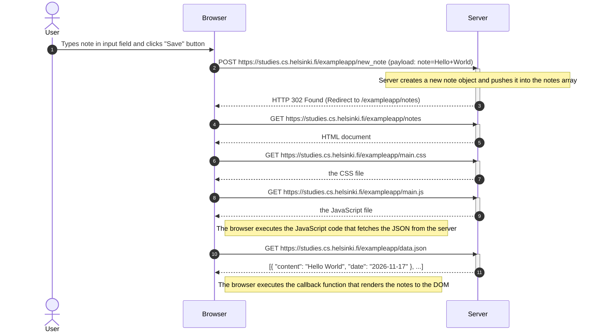

# Exercise 0.4: New Note Diagram

Sequence diagram depicting the situation where a user creates a new note on the traditional multi-page application (`https://studies.cs.helsinki.fi/exampleapp/notes`).

