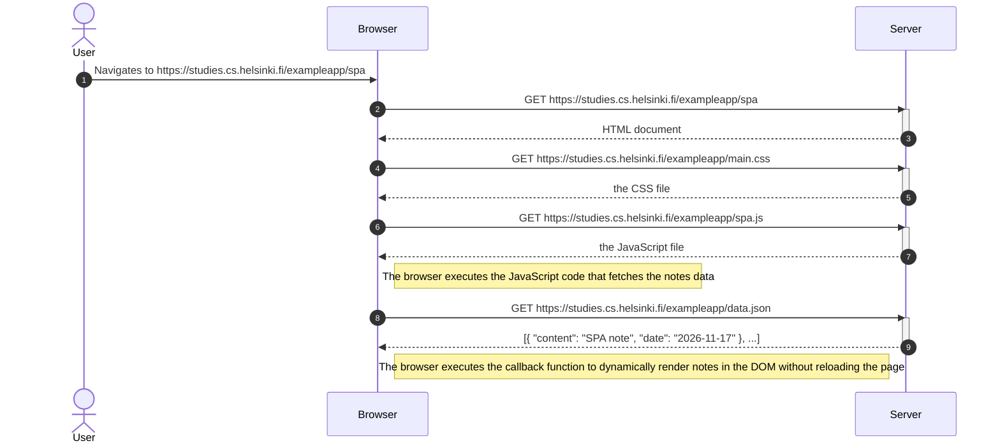

# Exercise 0.5: Single Page App Diagram

Sequence diagram depicting the situation where a user navigates to the single page app version of the notes app (`https://studies.cs.helsinki.fi/exampleapp/spa`).

