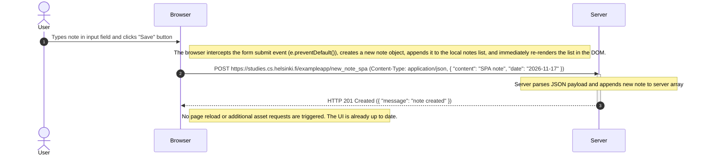

# Exercise 0.6: New Note in Single Page App Diagram

Sequence diagram depicting the situation where a user creates a new note in the Single Page Application version (`https://studies.cs.helsinki.fi/exampleapp/spa`).

